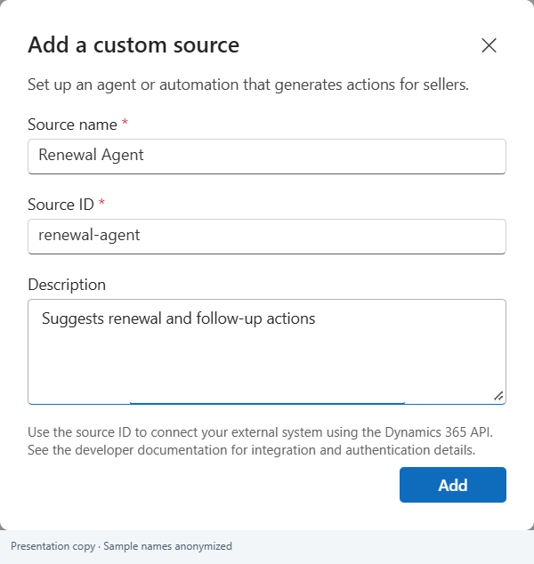
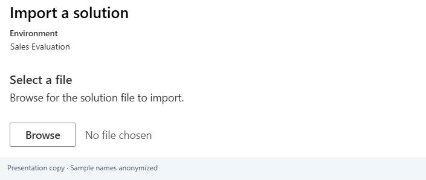
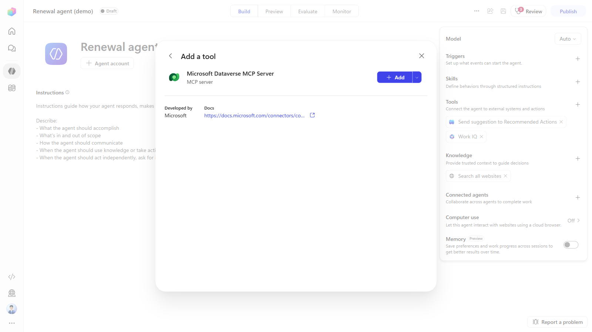
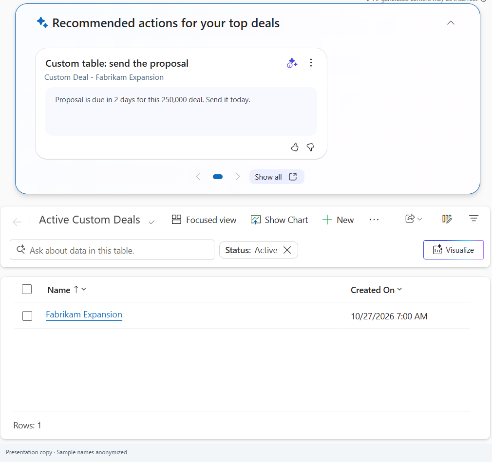

# Connect your custom agent to Recommended Actions

Recommended Actions in Dynamics 365 Sales shows sellers prioritized suggestions on their list pages and on **Sales home**. You can connect your own agent so that its suggestions are ranked and shown alongside the suggestions that Microsoft provides.

This article describes three steps:

1. Register your agent as a source.
1. Enable your table (only for tables other than Opportunity, Lead, and Contact).
1. Connect your agent by using the Dataverse MCP Server in Copilot Studio.

For more information, see [Configure Recommended Actions agent: add custom agents](https://learn.microsoft.com/dynamics365/sales/configure-recommended-actions).

## Prerequisites

- You have the System Administrator role in the environment. Try the steps in a test environment first.
- You have the licenses that Recommended Actions requires. For details, see [Configure Recommended Actions agent](https://learn.microsoft.com/dynamics365/sales/configure-recommended-actions).
- In **Dynamics 365 AI hub** > **Create and manage agents** > **Prerequisites**, every item shows **Done**. If an item doesn't, select **Set up** next to it. Recommended Actions uses Copilot credits.
- The account that your agent uses to connect to Dataverse has access to Recommended Actions.

## Step 1: Register your agent

Register your agent as a recommendation source. Its **Source ID** identifies the source of each suggestion.

1. In **Sales Hub**, go to **App Settings** > **Dynamics 365 AI hub** > **Create and manage agents**.
1. Open **Recommended Actions**. If it isn't listed, select **Create** > **Recommended Actions** > **Choose**, enter a name, and select **Save**.
1. Select **Sources** > **New custom source**, and enter the following values:

   | Field | Example | Notes |
   |---|---|---|
   | Source name | Renewal Agent | A descriptive name for your agent |
   | Source ID | `renewal-agent` | Short, with no spaces. You need this value in Step 3. |
   | Description | Suggests renewal follow-ups | Optional |

1. Select **Add**, then **Save** and **Start agent**. If the agent is already on, select **Apply changes**.

   

Your agent appears under **Custom sources**, and Recommended Actions shows **On**.

If your agent only sends suggestions for opportunities, leads, or contacts, go to [Step 3](#step-3-connect-your-agent-by-using-the-dataverse-mcp-server).

## Step 2: Enable your table

This step enables an additional table to receive, rank, and show suggestions. It has two parts:

- **Import a solution**, which lets suggestions point to the table's records and turns on the suggestions panel.
- **Add ranking signals**, which tell Recommended Actions which columns show how valuable and how urgent a record is.

Neither part creates records or suggestions.

> [!NOTE]
> Recommended Actions already supports accounts as targets and includes ranking signals for them. Import the Account solution only if the Recommended Actions panel doesn't appear on the Accounts list.

### Part 1: Import the solution for your table

1. Download the managed solution for your table:

   | Table | Solution file |
   |---|---|
   | Account | [RecommendedActions_Account_account_managed.zip](../solutions/RecommendedActions_Account_account_managed.zip) |
   | Case | [RecommendedActions_Case_incident_managed.zip](../solutions/RecommendedActions_Case_incident_managed.zip) |
   | Email | [RecommendedActions_Email_email_managed.zip](../solutions/RecommendedActions_Email_email_managed.zip) |
   | Appointment | [RecommendedActions_Appointment_appointment_managed.zip](../solutions/RecommendedActions_Appointment_appointment_managed.zip) |
   | Task | [RecommendedActions_Task_task_managed.zip](../solutions/RecommendedActions_Task_task_managed.zip) |
   | Phone Call | [RecommendedActions_PhoneCall_phonecall_managed.zip](../solutions/RecommendedActions_PhoneCall_phonecall_managed.zip) |
   | Quote | [RecommendedActions_Quote_quote_managed.zip](../solutions/RecommendedActions_Quote_quote_managed.zip) |
   | Order | [RecommendedActions_Order_salesorder_managed.zip](../solutions/RecommendedActions_Order_salesorder_managed.zip) |
   | Invoice | [RecommendedActions_Invoice_invoice_managed.zip](../solutions/RecommendedActions_Invoice_invoice_managed.zip) |

1. Go to [Power Apps](https://make.powerapps.com), select your environment, and then select **Solutions** > **Import solution**.
1. Select **Browse**, choose the file, and then select **Next**.
1. Select **Import**.

   

To remove a table solution later, go to **Solutions** in Power Apps, select the solution, and then select **Delete**.

For a table that your organization created, see [Enable a custom table](detailed-guide.md#enable-a-custom-table).

### Part 2: Add ranking signals

Recommended Actions shows only suggestions that it ranks as important and time-sensitive. For a newly enabled table, you specify which columns indicate value and urgency. This part isn't needed for Opportunity, Lead, Contact, or Account.

1. Open **Sales Hub** in the same environment, signed in as a System Administrator.
1. Press **F12**, select the **Console** tab, paste the contents of [Set-Table-Signals.js](../scripts/Set-Table-Signals.js), and press **Enter**. For details, see [Ranking signals](detailed-guide.md#ranking-signals).
1. Complete the dialog boxes:

   | Dialog box | What to enter | Why |
   |---|---|---|
   | Table | The table's logical name, for example `quote` | Identifies the table whose suggestions are ranked |
   | Value column | A currency or number column, for example `totalamount` | Higher values get higher priority. Records with no value are excluded. |
   | Due-date column | A date column, for example `effectiveto` | Overdue records and records that are due soon get higher priority. |

   For the provided tables (Quote, Order, Invoice, Case, Email, Appointment, Task, and Phone Call), the columns are entered for you.

1. Review the preview, and select **OK** to save. A backup file of the current settings downloads first.

The script displays **Saved and verified**. Ranking uses the new settings within an hour.

## Step 3: Connect your agent by using the Dataverse MCP Server

Your agent sends each suggestion by calling the Recommended Actions API `msdyn_PushActionDataToRecommendedActionAgent`. In Copilot Studio, the **Microsoft Dataverse MCP Server** tool can call this API through its **Invoke api** tool.

1. Make sure that the Copilot Studio MCP client is allowed for the environment. In the Power Platform admin center, select the environment, and then go to **Settings** > **Product** > **Features** > **Dataverse Model Context Protocol**.
1. In Copilot Studio, open your agent, and then select **Tools** > **Add a tool** > **Model Context Protocol** > **Microsoft Dataverse MCP Server**. Choose a Dataverse connection, and then select **Add to agent**.

   

1. Paste the following instruction into the agent's **Instructions**. Replace `renewal-agent` with your Source ID from Step 1, and then select **Save**.

   ```text
   When you find something a seller should do on a Dynamics 365 record, send it to Recommended Actions with the Dataverse MCP tool "Invoke api". Use apiUniqueName "msdyn_PushActionDataToRecommendedActionAgent" and these apiInputs. Every value is a string:
   - msdyn_SourceAgentId: "renewal-agent"
   - msdyn_ActionId: "<table>_<record id>_<today as yyyyMMdd>"
   - msdyn_TargetEntityTypeName: the table's logical name, for example "opportunity"
   - msdyn_TargetEntityId: the record id, lowercase, no braces
   - msdyn_ActionReason: one sentence saying what to do, why, and by when
   - msdyn_ActionUIPayload: this JSON, as a string: {"version":"1.0","payload":{"header":"<short title>","description":"<the reason>","oncardClickActionType":"Navigate","oncardClickActionTypeParameters":"{etn=\"<table>\", id=\"<record id>\", pagetype=\"entityrecord\"}"}}
   - msdyn_ActionPrioritizationData: this JSON array, as a string: [{"actionHeader":"<short title>"},{"actionDescription":"<the reason>"}]
   If the call succeeds, reply "Suggestion sent." If it fails, show the error. Never change the record itself.
   ```

1. In the agent's test chat, ask the agent to send a suggestion for an existing test record. The first time, approve the **invoke_api** request.

The agent replies **Suggestion sent**. After ranking, eligible suggestions appear on the table's list page. Suggestions might not appear immediately.

> [!IMPORTANT]
> The Dataverse MCP Server runs with the connection that you choose when you add the tool. **Invoke api** can call any Dataverse API that the account can access, so keep the agent's instruction specific, as shown.

For Power Automate flows, other agents, and code samples, see [Send suggestions without Copilot Studio](detailed-guide.md#send-suggestions-without-copilot-studio).

## What sellers see

Eligible suggestions can appear in **Recommended actions** at the top of the table's list page and on **Sales home**. Selecting a card opens the record.



## Troubleshooting

| Message or symptom | Resolution |
|---|---|
| "No source agent configuration found" | Make sure that the Source ID in your agent's instruction exactly matches the Source ID from Step 1. |
| "Creating Entity with an invalid parent" | The table isn't enabled yet. Complete Step 2. |
| No suggestions appear after a few hours | Check that the suggestion was received, how it was ranked, and that the table's panel is turned on. Make sure that the table's value and due-date signals are set. |
| "You do not have permission" on the table's list | Make sure that the table is included in the published app, and that the seller has access to the table, its records, and the app. |
| "Access denied" when sending | The account or connection that runs the agent needs access to Recommended Actions. |

## Related information

- [Custom agent onboarding: detailed guide](detailed-guide.md)
- [Configure Recommended Actions agent](https://learn.microsoft.com/dynamics365/sales/configure-recommended-actions)
